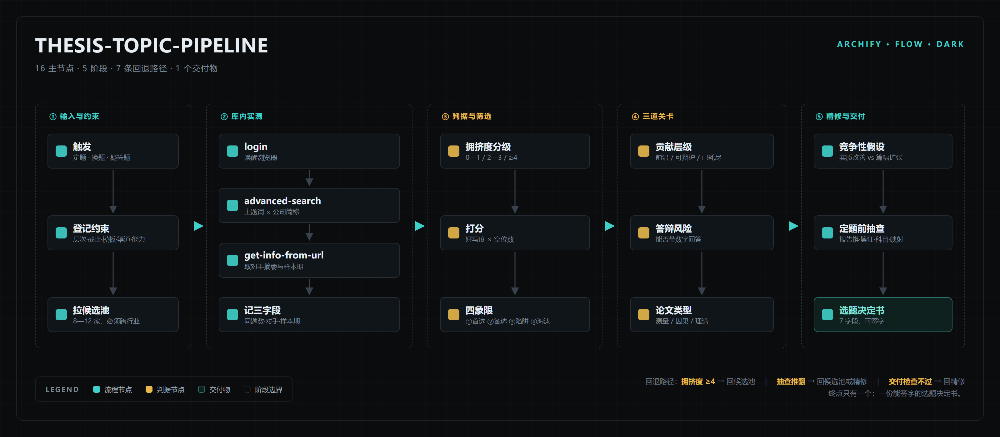

# thesis-topic-pipeline · 毕业论文选题流水线

一个给**案例型毕业论文**（"关于 XX 企业……的问题及对策研究"这一模板）用的选题 skill。

它的存在只为一件事：**别让你花两个月写一个已经被写过八次的题。**



## 核心命题

**"好写"和"没人写过"是负相关的。**

按"资料最好找"排序，必然选出被写烂的那家公司——这不是运气差，是排序标准只有一根轴。

所以这个 skill 强制先做一件事：**去库里数一数**。

## 七阶段

| 阶段 | 动作 | 产出 |
|---|---|---|
| 1 | 登记约束（层次 / 截止 / 模板 / 数据渠道 / 能力） | 约束表 |
| 2 | 拉候选池，8—12 家，**必须跨行业** | 候选长表 |
| 3 | **库内实测**：数同题学位论文 | 每家三字段 + 分级 |
| 4 | 二维筛选：好写 × 空位 | 四象限矩阵 |
| 5 | 三道关卡：贡献层级 / 答辩风险 / 论文类型 | 判定 |
| 6 | 精修：一句话 + 竞争性假设 + 3—5 维设计 | 最小可行设计 |
| 7 | 定题说明 | **选题决定书** |

终点是"题"，不是"论文"。开题报告、文献综述、正文写作一律不在此流程内——各校模板差异太大，无法适配。

## 依赖

第 3 步需要一个能查知网的 MCP，通常用 [cnki-mcp](https://github.com/sepinetam/cnki-mcp)。
没有的话 skill 会降级，并明确标注"未验证"，不会编数字。

## 安装

把整个目录放进你的 agent skills 目录即可：

```bash
# DSH / 兼容 Agent Skills 的目录
cp -r thesis-topic-pipeline ~/.dsh/skills/
# 或项目内
cp -r thesis-topic-pipeline .dsh/skills/
```

## 校准数据（2026-10 实测）

主题词 `ESG信息披露`，同题学位论文数：

| 公司 | 同题数 | 分级 |
|---|---|---|
| 伊利股份 | 8 | 饱和 |
| 贵州茅台 | 3 | 中 |
| 海螺水泥 | 3 | 中 |
| 牧原股份 | 2 | 中 |
| 宝钢股份 | 0 | 低 |
| 紫金矿业 | 0 | 低 |

由此校准的阈值：**0—1 低 / 2—3 中 / ≥4 高 / ≥7 饱和**。

⚠️ **样本只有五家。** 阈值是经验值，不是统计结论。跑够十个案例后应该重新校准——这条写在 `SKILL.md` 的"适用边界"里。

## 结构

```
SKILL.md                              主流程、三条硬规则、输出契约
references/crowding-probe.md          检索配方、阈值、工具坑
references/screening-and-gates.md     二维矩阵、四象限动作、关卡判定
references/refinement-blueprint.md    一句话模板、竞争性假设、财务勾稽落点
references/examples.md                一次完整实跑（含被否掉的选项）
```

## 适用边界

- 适用于单案例、模板化的经管类毕业论文
- 不适用于需要因果识别的实证题、理论题、结构模型题
- 只管到定题，不管开题之后

## License

MIT
